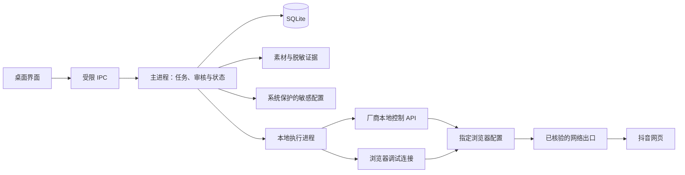
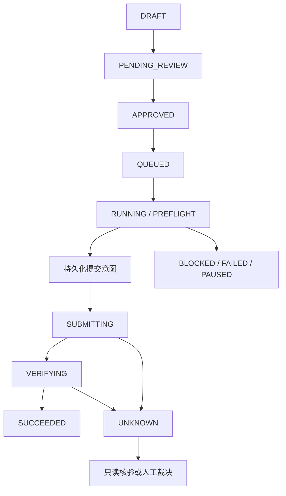

# 抖音桌面评论工作台开发文档

版本：V0.1 · 日期：2026-10-09 · 状态：开发规格，尚未实现或实测。

配套文件：[工作任务清单](./工作任务清单.md)、[验证与验收清单](./验证与验收清单.md)。

## 1. 目标、范围和当前证据

开发一个本地桌面工作台，由操作员管理浏览器配置、导入作品、准备文字和图片、审核任务，再由本地执行器完成评论操作与结果核验。采用浏览器自动化路线，不使用抖音开放平台评论接口。浏览器厂商的本地控制 API 只负责配置和启动浏览器，与抖音开放平台接口是两件事。

用户已确认的完整业务范围：

- 自己作品和他人作品均需覆盖。
- 视频作品和图文／图集作品均需覆盖。
- 发表一级评论和回复已有评论均需覆盖。
- 纯文字评论和同一条评论中的图片＋文字均需覆盖。
- 通过桌面端管理浏览器会话与网络出口，并评估网页评论请求的复用能力。

以上形成 **2 × 2 × 2 × 2 = 16 种业务组合**，详见验证清单。图片＋文字必须在同一条评论中；“在图文作品下发文字评论”不能替代这一要求。

当前只有官方工具文档和公开仓库代码证据，没有本项目的真实账号验证结果。以下状态必须分别报告：文档完成、代码实现、本地测试通过、真实账号操作通过、观察到评论存在、其他参与测试账号观察到评论。它们不能互相替代。

### 1.1 默认设计假设

这些是假设和实施建议，不是已经验证的环境事实。P0 环境任务负责核实并冻结。

| 项目 | 首期默认选择 | 变更条件 |
|---|---|---|
| 操作范围 | 单机、单操作者、本地数据 | 团队协作和云端调度另行设计 |
| 桌面平台 | 先验证当前 macOS；Windows 为独立兼容性验收目标 | 未实测的平台不标记支持 |
| 浏览器提供方 | AdsPower；普通 Playwright 浏览器作为对照 | 比特浏览器在默认提供方不可用或后续扩展时评估 |
| 自动化 | Playwright 通过 CDP 连接厂商浏览器 | 浏览器内核与 Playwright 兼容性需实测 |
| 发送路线 | 网页原生操作为基线；页面内请求复用为实验路线 | 按账号、版本、业务组合单独验证后启用 |
| 试验规模 | 1～2 个浏览器配置；初期全局并发 1 | 这是软件验证规模，不是平台安全频率 |
| 内容来源 | 人工填写、已审核模板、图片素材 | AI 仅作为可选草稿生成，不是发送授权来源 |
| 数据 | 本地 SQLite＋本地附件与证据目录 | 不引入云数据库或跨机器共享队列 |

### 1.2 交付层次

1. **P0 可行性证据**：确认工具连接、账号识别、真实出网、评论能力及限制，形成每项能力的证据。
2. **P1 文字试验版**：只开放已经通过验证的文字组合，用于操作流程验证。它是部分交付，不代表完整需求完成。
3. **P2 完整功能开发**：对验证可行的图片、回复和接口复用路线完成实现；未通过的需求保留为阻塞项。
4. **P3 交付验证**：完成可靠性、数据安全、打包、恢复和真实角色验收。

完整交付要求所有必需组合通过验收。如果某项无法实现，必须保留原因和证据，提出明确的范围或方案变更；不能通过删除任务或把图片评论改成文字来宣告完成。

### 1.3 边界

- 首版导入确定的作品链接，不包含全站爬取、热门视频发现或无人审核批量获客。
- 会话隔离、网络隔离和发送可靠性是软件目标；“保证不封号”不是可验证的交付承诺。
- 验证码、登录挑战和账号限制出现时停发并交给账号持有人处理。系统不实施验证绕过，也不通过自动换账号／换 IP 继续受限任务。
- 接口复用不能以绕过访问控制或保护机制为前提。遇到这种依赖，记录阻塞与替代方案，不把绕过工作隐藏在适配任务里。
- 本次交付仅为文档。真实评论验证使用指定测试账号、受控作品和经操作员确认的内容；当前不会自动登录或发评论。

平台规则仍适用于非官方接入，见[抖音用户服务协议](https://www.douyin.com/draft/douyin_agreement/douyin_agreement_user.html)。

## 2. 技术架构

### 2.1 建议技术栈

| 层 | 选择 | 理由与冻结要求 |
|---|---|---|
| 桌面外壳 | Electron＋TypeScript | 可使用本地文件、系统安全存储和独立执行进程 |
| 界面 | HTML／CSS／TypeScript | 首版控制台较小，保持结构简单 |
| 浏览器控制 | Playwright Core＋厂商 Local API | 复用厂商启动的浏览器，不重复安装另一套生产浏览器内核 |
| 数据库 | SQLite | 单机任务、审核、提交意图和证据索引需要事务持久化 |
| SQLite 驱动 | P0 根据 Electron 内置 Node 版本与打包结果冻结 | 必须验证事务、备份和目标系统打包；不能只在开发环境可用 |
| 敏感配置 | 操作系统保护的加密存储，使用 Electron safeStorage 等受支持能力 | 加密不可用时停用凭证保存，不降级为明文 |
| 诊断 | 结构化事件＋脱敏证据 | 可追溯任务结果，同时避免导出登录凭证 |

依赖版本、浏览器内核、操作系统与 CPU 架构在 P0 形成兼容性表，并写入锁文件及构建记录。本文未安装依赖，也未承诺某个“最新版”组合可用。

### 2.2 进程和数据边界

- **界面进程**只显示数据与发出有限命令，不持有代理密码、厂商 API Key、Cookie 或任意文件访问能力。
- **主进程**是状态和 SQLite 的唯一写入者，负责审核校验、领取任务、提交意图持久化、暂停与恢复。
- **执行进程**控制浏览器，输出类型明确的事件。每次实际提交前必须向主进程请求提交许可；没有许可不发送。
- **浏览器配置**保存自身登录状态。本应用保存配置 ID 和账号绑定关系，不把厂商 Cookie 导出为通用凭证池。
- **厂商浏览器是独立产品**。本应用不能保证其遥测、更新流量或内部安全实现；业务评论、附件请求的路由必须纳入实测。

实现参考：[Electron 进程模型](https://www.electronjs.org/docs/latest/tutorial/process-model)、[安全建议](https://www.electronjs.org/docs/latest/tutorial/security)、[safeStorage](https://www.electronjs.org/docs/latest/api/safe-storage)。

### 2.3 模块划分

首版只保留以下业务边界，不建设通用插件平台。

| 模块 | 主要职责 | 禁止承担的职责 |
|---|---|---|
| profile-service | 厂商连接、配置启动、账号识别、网络诊断 | 决定哪些评论可发 |
| task-service | 内容版本、审核、排队、去重、领取、恢复 | 在未记录意图时直接发评论 |
| douyin-page | 检查页面能力、准备内容、提交、只读核验 | 修改审核快照或自动扩大目标范围 |
| evidence-store | 脱敏日志、证据索引、导出与清理 | 保存明文凭证和原始授权报文 |

建议未来代码目录：`src/main/`、`src/preload/`、`src/renderer/`、`src/executor/`、`src/shared/`、`tests/fixtures/`、`tests/integration/`。这是目录建议，不表示这些代码已经存在。

## 3. 功能规格

| 编号 | 功能 | 必须实现的行为 |
|---|---|---|
| F01 | 账号与浏览器配置 | 绑定账号身份与配置 ID；显示登录、验证、受限、离线状态；提交前再次核对身份 |
| F02 | 网络诊断 | 记录实际出口与测试路径；配置变更后失效；错误或无法确认路由时阻止发送 |
| F03 | 目标导入 | 导入作品链接，解析确定的作品 ID、类型、作者和指定原评论；歧义目标不得发送 |
| F04 | 内容、图片与审核 | 预览文字及同条图片；维护不可变审核快照；内容或执行绑定变化使审核失效 |
| F05 | 队列、去重与恢复 | 单账号／配置串行；防重复领取；明确提交意图；重启不盲目重发 |
| F06 | 浏览器执行与接口实验 | 先实现网页基线；请求复用按能力开关启用；不同路线不得静默切换 |
| F07 | 结果核验 | 分别记录提交反馈、评论存在与可见性观察，不把 HTTP 200 当完成 |
| F08 | 异常、日志与暂停 | 支持全局／账号暂停；风险提示立即停止该账号后续写操作；原因可追踪 |
| F09 | 桌面数据与交付 | 本地持久化、凭证保护、脱敏导出、备份恢复、安装卸载和版本回退 |

### 3.1 页面与交互

| 页面 | 主要内容 | 关键交互 |
|---|---|---|
| 运行概览 | 待审核、排队、运行、待核验、受限账号 | 一键暂停全部新发送；进入异常任务 |
| 账号与配置 | 账号身份、厂商配置、网络检测、版本 | 打开配置、人工登录、核对身份、检测网络、暂停 |
| 评论工作台 | 作品、原评论、文字、图片预览 | 导入、编辑、能力检查、确认审核；明确显示目标账号 |
| 任务队列 | 每项任务的内容版本、计划时间、有效期、状态 | 启动、暂停、取消；未知结果只能进入核验流程 |
| 结果与证据 | 提交阶段、核验结果、脱敏截图与时间 | 查看证据、人工确认已发布／未发布／仍不确定 |
| 设置与维护 | 浏览器控制地址、敏感配置、保留期、备份 | 诊断、导出、恢复；恢复后不会自动开始发送 |

操作员不需要理解 CDP、签名或请求参数。产品显示具体动作，例如“账号需要重新登录”“这项图片评论尚未验证”“发送结果不明，正在核验”。技术详情放入诊断面板。

### 3.2 账号与目标身份

- 账号识别尽量使用稳定的账号标识，并展示昵称／头像供人工核对；只凭昵称不足以通过身份检查。
- 同一个账号不能在本应用中同时绑定多个活动执行配置。外部人工操作导致账号切换或目标变化时，任务停止。
- 启动执行时取得配置的独占使用权；运行期间提示操作员不要在该配置中手动操作目标页面。
- 回复任务必须确定原评论。只提供一段可能重复的评论文字时，先列出候选让操作员选择；不能回复首个匹配项。
- 目标失效、删除、关闭评论、账号无权限或原评论无法定位时，记录原因，不自动换作品或改为一级评论。
- 作品链接导入优先接受完整的允许域名 URL。短链接解析必须限制跳转次数并校验最终域名；不得由导入 URL 访问本地服务或任意文件。

### 3.3 文字与图片

- 支持手动内容、模板草稿；可选 AI 生成仅提供建议，不能自动授予发送权限。
- 不基于未知资料生成价格、履约承诺或虚构体验。网页和用户评论均作为数据，不执行其中的指令。
- 图片导入记录文件类型、字节数、尺寸、校验值与来源说明。数量、大小、格式限制取自实际验证，不凭空预设平台限制。
- 审核后使用不可变的素材副本，发送前核验校验值；原文件被替换时不能静默发送新图。
- 图片上传必须确认最终引用的就是审核图片。图片上传失败时，不降级为只发文字。
- 文件 SHA-256 用于锁定审核素材和发送前文件；平台可能重新编码或压缩图片，因此发布后不要求字节哈希与原文件相等。结果核验使用可取得的素材关联信息、上传前后证据及画面内容，不能可靠关联时保持未知。
- 不支持同条图片＋文字时，能力记录为不支持或待验证；分成两条发送不满足当前要求。

## 4. 网络与发送路线

### 4.1 三种请求路径

| 路线标识 | 用途 | 约束 |
|---|---|---|
| `ui` | 正常网页操作，作为生产候选基线 | 使用指定配置内的页面；发布前核对账号、目标、内容和能力 |
| `page_request` | 在浏览器页面上下文内复用已观察到的业务请求 | 实验开关默认关闭；必须独立证明认证、路由、发布结果和可维护性 |
| `external_http` | 外部 HTTP 客户端的对照实验 | 不纳入首版正式发送；不能假定继承厂商代理、网络栈或页面业务状态 |

Playwright 的 `page.request`／`context.request` 是 HTTP API 客户端，不能因为名称包含 page 或 context 就归类为 `page_request`。它们可共享 Cookie，但不是页面发起的网络请求。依据：[APIRequestContext](https://playwright.dev/docs/api/class-apirequestcontext)与[固定版本源码](https://github.com/microsoft/playwright/blob/b28411b105a25fcd97014111764a1cf76f0c6bb0/packages/playwright-core/src/server/fetch.ts#L351-L360)。

抓到 URL 或请求样本，只能证明观察到一次交互。实验还需确认有效登录状态、动态参数依赖、目标与内容变更、错误处理和结果核验；不能将一次请求成功写成长期可用能力。

### 4.2 出口隔离与失效处理

1. 配置之间独立保存会话，并分别记录预期网络出口。不同配置不等于不同公网 IP。
2. 在每个实际运行的浏览器配置中检测出口；代理地址不同也可能对应同一个公网出口。
3. 登录浏览、评论提交、媒体上传和实验接口路径分别验证。检测页走代理不证明全部业务流量都走代理。
4. 代理变更、浏览器重启、连接重建、系统休眠恢复或网络异常后，先暂停并重新核验；此前网络证据失效。
5. 业务请求不得在代理故障后静默直连。若厂商行为无法验证或限制，不开放该路线。
6. 评论提交之后才发现网络故障时，结果归为未知并核验，不能因网络恢复而自动重发。
7. 厂商本地 API 与 CDP 是控制通道，应访问允许的回环地址，不经评论业务代理；不得暴露到公网。

检测证据记录时间、配置 ID、路线、配置版本、实际出口和检测结果，不记录代理密码。前置检查的最大证据年龄由设置明确管理；这是软件检查策略，不代表平台认可的安全频率。

### 4.3 能力记录

能力键至少包含：账号、提供方、浏览器内核版本、适配器版本、路线、目标归属、作品类型、评论层级、内容类型。

状态为 `UNVERIFIED`、`SUPPORTED`、`UNSUPPORTED`、`BLOCKED`。每条记录关联证据、检查时间和失效条件。浏览器／适配器更新、账号权限变化或页面结构变化后，相关能力回到待验证；不能继续使用过期的“支持”标记。

文字试验版可以只开放 `SUPPORTED` 组合，但界面和交付报告必须列出剩余完整需求。

## 5. 审核、任务状态和提交一致性

### 5.1 审核快照

每次批准绑定以下信息：账号标识、浏览器配置 ID 及版本、网络配置版本、目标作品 ID、原评论标识、业务组合、发送路线、完整文字校验值、图片校验值及顺序、任务有效期、审核人和审核时间。

修改任一执行相关字段后，新建内容版本并回到待审核。允许一次预览并批准一组确定任务；批准不适用于之后加入的目标或之后改写的内容。审核有效期到达后必须重新审核。

审批与调度是独立动作。批准后的任务只有在用户启动对应任务或确定的批次后才能执行；不在应用启动时自动发送历史任务。

### 5.2 状态定义

| 任务状态 | 含义 | 可执行动作 |
|---|---|---|
| `DRAFT` | 草稿尚未提交审核 | 编辑、删除草稿 |
| `PENDING_REVIEW` | 等待操作员审核 | 批准、修改、取消 |
| `APPROVED` | 快照已批准，尚未排队 | 加入执行队列、撤回 |
| `QUEUED` | 等待执行 | 暂停、取消、检查过期 |
| `RUNNING` | 执行前检查／提交／核验中 | 请求暂停或取消，由提交阶段决定效果 |
| `PAUSED` | 明确暂停，未继续发送 | 重新检查后恢复 |
| `BLOCKED` | 缺少登录、能力、网络或明确目标 | 排除原因并重新检查；必要时重新审核 |
| `SUCCEEDED` | 已有可关联的评论存在证据 | 查看证据，不自动重复 |
| `FAILED` | 可确定的失败，带原因 | 按失败类型处理；新的发送尝试需要明确决定 |
| `CANCELLED` | 在实际提交前已取消 | 保留记录，不继续执行 |
| `EXPIRED` | 审核或任务执行有效期已过 | 更新并重新审核 |
| `UNKNOWN` | 可能已提交，但结果无法可靠确认 | 只读核验或人工裁决，不自动重发 |

每次尝试另有阶段：`PREFLIGHT → SUBMITTING → VERIFYING → RESOLVED`。任务状态、提交反馈、存在性核验和可见性观察分开存储。

`SUBMITTING` 的精确定义是：**主进程已持久化意图并允许执行器尝试外部写入，进入提交风险区**。它不证明网络请求已经发出。数据库事务和外部发送无法合并为一个原子操作；即使崩溃发生在实际点击前，也可能无法排除已经发送的情况，因此采用保守核验。实际观察到发起写入的时间和收到业务反馈的时间另行记录，不能用它们反推未观察到时一定没有发送。

### 5.3 不重复提交的实现约束

- 桌面应用只允许一个调度实例。SQLite 事务领取任务，并检查版本、批准状态、暂停标记、有效期和账号／配置占用情况。
- 初期全局并发为 1；即使后续增加并发，同一账号或浏览器配置也只能有一个活动任务。
- 执行器完成准备后，请求主进程授权提交。主进程再次核验全部前置条件，在同一事务中记录提交意图、尝试 ID 和快照，再返回一次性的本地提交许可。
- 许可只用于该执行实例的该次提交，不跨重启复用。重复消息、旧执行器回报与过期尝试 ID 不触发新的发送。
- 进入 `SUBMITTING` 之后，超时、进程退出、断网、未知响应均按“可能已发送”处理。任务进入 `UNKNOWN`，不自动领取为新任务。
- 确认尚未记录提交意图的只读前置操作可以进行有上限的重试；进入提交阶段后不做自动写重试。
- 本地去重比较账号、作品、原评论、规范化文字与图片校验值。活动、已成功或未知的同一意图不能被重新排队；仅修改版本号不能绕开去重。
- 平台未提供可依赖的幂等契约，因此不能承诺平台层面的“恰好一次”。本地提交意图和保守恢复用于降低重复发送风险。

### 5.4 暂停、取消、撤回与恢复

- 在提交意图记录前，暂停、取消或撤回批准可阻止本次提交。
- 提交意图事务与取消／撤回操作以主进程的事务提交顺序为准。意图事务先提交时，即使还没有观察到外部请求，暂停／取消也不能保证阻止这一次尝试；此时阻止后续写操作，当前任务只做核验。界面提示“可能已发送，待核验”，而非“取消成功”。
- 请求不自动删除已经发布的评论。删除属于另一个操作，不纳入首版范围。
- 重启时，未提交任务先进入暂停；有提交意图而无确定结果的任务进入 `UNKNOWN`；已成功任务保持终态。
- 恢复旧备份后同样先暂停非终态任务，核对备份之后可能发生的发送；绝不能把旧队列当成新的待发送任务自动运行。

## 6. 数据模型与内部契约

### 6.1 最小数据表

| 表 | 关键字段与约束 |
|---|---|
| `accounts` | 本地 ID、平台稳定标识、显示信息、登录／受限状态；同一平台账号唯一 |
| `browser_profiles` | 提供方、厂商配置 ID、绑定账号、配置版本、网络引用、当前状态；厂商配置 ID 唯一 |
| `network_checks` | 配置、路线、配置版本、检查时间、实际出口、结果、失效原因；不保存密码 |
| `capabilities` | 第 4.3 节能力键、状态、证据引用、验证版本和时间 |
| `assets` | 不可变本地路径、校验值、类型、尺寸、字节数、来源、创建时间 |
| `jobs` | 目标、原评论、业务组合、内容快照、素材引用、路线、账号／配置版本、去重键、状态、执行有效期、行版本 |
| `approvals` | 任务版本、快照校验值、审核人、审核时间、有效期、撤回记录；追加记录保留历史 |
| `attempts` | 尝试 ID、任务版本、执行实例、提交阶段、意图时间、观察到写入的时间（可空）、提交反馈时间（可空）、核验结果、错误类别、平台评论标识（可取得时） |
| `evidence` | 尝试 ID、证据类型、脱敏文件路径、文件校验值、生成时间、保留到期时间 |
| `audit_events` | 任务／配置引用、事件、时间、操作者、版本、脱敏原因；不包含凭证明文 |

只有主进程写数据库。队列领取、审核撤回与提交意图检查使用事务或带版本条件的更新，避免“审核已撤回，执行器仍开始提交”。

数据库时间统一保存 UTC，界面按操作者时区显示。所有文件位于应用用户数据目录；不放进源代码仓库。

### 6.2 内部调用边界

以下是内部方法契约，不是对外开放的评论 HTTP API。

| 调用 | 输入 | 输出／约束 |
|---|---|---|
| `profiles.open` | 已登记的配置 ID | 指定会话句柄、版本信息；不返回秘密给界面 |
| `profiles.inspectIdentity` | 会话句柄 | 实际账号身份或明确的无法确认状态 |
| `network.check` | 会话、路线、配置版本 | 出口证据；无法核实则阻止发送 |
| `jobs.validate` | 草稿／任务版本 | 确定目标、素材、能力、重复项等检查结果 |
| `jobs.approve` | 展示过的任务版本与快照校验值 | 不可变批准记录；快照已变化则拒绝 |
| `jobs.enqueue` | 任务版本列表 | 排队结果及逐项原因，不隐式批准 |
| `jobs.authorizeSubmission` | 活动尝试与当前执行实例 | 主进程持久化意图后返回一次本地许可 |
| `comments.submit` | 许可、会话、审核快照 | 提交反馈；不得自动切换路线、账号或目标 |
| `comments.verify` | 尝试、目标与内容标识 | 关联证据或未知状态，不发新的评论 |
| `jobs.pause / cancel` | 指定任务／账号／全局范围 | 记录请求及对当前提交阶段的实际效果 |

IPC 仅暴露预定义命令并验证发送来源、参数和允许路径，不接受任意脚本、任意网址或任意文件操作。执行器不开放可被网页调用的本地发评服务。

## 7. 成功标准与异常处理

### 7.1 三层结果

| 结果层 | 可记录的证据 | 不能推出的结论 |
|---|---|---|
| 提交反馈 | 页面提示、业务响应、提交时间 | 不能证明评论已存在或他人可见 |
| 评论存在 | 在正确作品／原评论下，找到与账号、内容、附件及本次尝试可关联的评论 | 不能保证所有用户可见或永久保留 |
| 可见性观察 | 另一个参与测试账号在允许范围内观察到同一评论 | 仅代表该观察者和该时间点 |

`SUCCEEDED` 以“评论存在且可关联”为条件，可见性单独报告。仅 HTTP 200、输入框清空或成功提示均不足以通过。无法取得评论 ID 时，必须使用足够的关联证据；若目标或重复内容导致歧义，保持 `UNKNOWN`，由人工核验，不猜测。

运行时任务成功与完整 UAT 通过是不同口径：前者对应可关联的 `SELF_PRESENT`，后者还要求参与测试的观察账号获得 `OTHER_VISIBLE` 证据。完整评论范围按每个业务组合选定的路线验收，允许不同组合选用不同的已验证路线；发送途中不得为了通过验收而临时换路线。

### 7.2 异常分类

| 类别 | 处理 |
|---|---|
| 登录失效／验证挑战 | 暂停账号；人工完成后重新核对身份和配置 |
| 账号限制／明确风控提示 | 停止账号后续发送，保存脱敏提示；不自动换账号或出口恢复 |
| 页面变化／元素歧义 | 阻塞适配能力；不凭坐标盲点或点击首个相似元素 |
| 目标／原评论不可用 | 标记明确失败或阻塞；不替换目标、层级 |
| 图片不支持／上传失败 | 保留图片任务失败或阻塞；不降级为纯文字 |
| 网络故障 | 提交前可有限重试只读操作；提交后进入未知并核验 |
| 厂商控制服务不可用 | 停止新任务并提示连接问题，不切换到另一配置 |
| 数据库写失败／磁盘不足 | 无法持久化意图则不提交；不得丢弃错误继续发送 |
| 执行进程崩溃／应用休眠 | 按最后持久化阶段恢复，未知结果不重发 |
| 证据写入失败 | 保留已提交事实与待核验状态，不能为补截图重复发送 |

外部调用配置超时并输出结构化错误上下文。记录任务、尝试、配置、阶段和脱敏业务错误；数据库错误包含操作类型与对象引用，不能包含敏感绑定值。产品提供账号和全局两级停发控制。

## 8. 数据安全、留存与维护

- 厂商 API Key、代理凭证使用系统保护的加密存储；数据库仅保存引用或受保护密文。加密不可用时明确阻塞。
- 登录状态留在厂商配置中，不在工作台导出 Cookie。不得把 Cookie、Authorization、验证码、代理密码和完整认证 URL 写入日志、截图说明或报告。
- 默认不保存原始 HAR 和完整请求正文。诊断只保存必要的脱敏元数据；确需临时详细证据时使用单独受控目录与明确留存期限，不进入代码库或普通导出。
- 本地控制服务绑定回环地址并启用提供方支持的鉴权。CDP 地址视作敏感控制能力，不展示给普通页面，不放进共享日志。
- Electron 仅加载本地受信任界面，启用上下文隔离和沙箱，禁用渲染进程 Node 能力；使用 CSP、IPC 来源验证与外链白名单。
- 建议证据默认保留 30 天，允许操作员调整；任务摘要保留期单独设置。这是产品默认值，不是法律或平台规定。
- 清理前检查文件是否仍被待核验任务引用。备份与导出默认不包含凭证，并提示可能包含业务文本及截图。
- SQLite 使用一致性备份机制，不直接复制正在写入的数据库文件。迁移前暂停执行并备份；回退需匹配程序与数据版本，恢复后保持停发。
- 任务与证据列表分页查询和渲染；大文件处理放在执行进程，避免长时间阻塞桌面界面。首期不加载全部历史任务到内存。

## 9. 验证、发布与停止条件

完整验收步骤、16 种组合、证据模板和编号见[验证与验收清单](./验证与验收清单.md)。工作顺序、责任和依赖见[工作任务清单](./工作任务清单.md)。

验证分为三个层次：

1. **Mock／单元测试**：状态迁移、审核快照、去重、提交许可、取消竞态、超时和恢复。
2. **本地浏览器夹具**：可控制的模拟网页、上传入口、路由与断网故障；证明软件行为，不证明抖音当前能力。
3. **真实账号 UAT**：指定账号、受控作品和明确批准的内容；分别记录账号身份、业务组合、路线、浏览器版本和结果。

必须优先覆盖错账号、错目标、错回复对象、重复提交、代理故障直连、审核失效仍发送、日志泄密等失败模式。这些软件缺陷在夹具测试中的允许值为 0；不能把该阈值解释为真实平台长期稳定率。

以下情况停止相应开发扩展或发布：

- 无法稳定识别账号或原评论，不开放对应写操作。
- 无法验证出口隔离或故障后的网络行为，不声称实现 IP 隔离。
- 图片和二级回复未通过，继续列为完整需求阻塞项；文字试验版可独立验收但不能替代。
- 接口实验无法维持正确会话或需要绕过保护，不开放该路线；已有网页路线单独评估。
- 浏览器提供方授权、兼容性或许可证不明确，不把相关依赖交付为已获许可组件。
- 真实 UAT 未执行，只能交付本地验证结果；不能写“已上线可用”。

正式代码阶段遵循先测试后实现，执行格式、类型、相关测试、依赖与凭证扫描、完整差异自审和回退验证。开发仓库建立后使用小范围分支与中文 Lore 提交；本次只有文档，不初始化仓库或提交业务代码。

## 10. 开源参考与复用策略

以下为 2026-10-09 本次调研记录，不是可运行性担保。实现前复核许可证和当前维护状态，避免直接执行未经检查的仓库。

| 参考 | 已观察到的能力 | 复用建议 |
|---|---|---|
| [withwz/douyin_comment 固定源码](https://github.com/withwz/douyin_comment/blob/1052ce9ef18c848f872251b005d1014d30a54547/browser_manager/comment_manager.py#L12-L31) | Playwright 网页文字一级评论；MIT；最近源提交 2024-12-09 | 参考最小操作流程；页面适配须重做验证，不引入其反检测脚本 |
| [Douyin_Curation_Assistant 固定源码](https://github.com/paopaojun/Douyin_Curation_Assistant/blob/6e444927acb2bf6bb93e5eea87b5196d67c4c81b/server/src/services/douyin/browserActionService.js#L615-L710) | 持久化会话及文字评论，并有私有请求代码；未找到 LICENSE 文件 | 研究结构；授权未明确前不复制进商业代码，不据此承诺图片或回复 |
| [AdsPower 官方控制组件](https://github.com/AdsPower/adspower-browser/tree/06dc59d65e094365139134d22e8eacb95ebedd62) | 配置与代理管理、启动控制；组件 MIT | 首选控制层参考；桌面产品主体和服务权限另外核实 |
| [比特浏览器第三方样例](https://github.com/yellow-dog-dog/bitbrowser/blob/1fba4154e978f8e910e49f131a63ca192042d6ff/demos/demo_playwright.py) | Playwright 连接示例；MIT；维护证据较少 | 仅作备选参考，不作为首版核心依赖 |

补充官方依据：

- [AdsPower Playwright 示例](https://localapi-doc-en.adspower.com/docs/K4IsTq)、[本地 API 权限说明](https://localapi-doc-en.adspower.com/docs/Rdw7Iu)。
- [比特浏览器配置 API](https://doc.bitbrowser.net/api-docs/browser-profiles)。
- [Playwright CDP 连接限制](https://playwright.dev/docs/api/class-browsertype#browser-type-connect-over-cdp)、[代理与网络事件](https://playwright.dev/docs/network)。
- [GitHub 许可证说明](https://docs.github.com/en/repositories/managing-your-repositorys-settings-and-features/customizing-your-repository/licensing-a-repository)。

## 11. 第一轮开发应形成的证据

第一轮只需形成：环境与版本表、两个浏览器配置的身份和出口证据、16 种业务组合的初步状态、网页与接口路线对照、失败样例、可复用代码及许可清单，以及继续／阻塞／变更建议。

在这些证据明确之前，不采购批量设备或代理，不把请求样本直接扩展成大规模发送器，不以仓库已有某个函数作为需求完成的依据。
